I build AI systems that have to work on a Tuesday at 3am, not just in a demo. Right now that's a voice agent for compliance investigators, search over millions of archived emails, and the open-weight LLM serving stack under all of it. Most of the job is making that cheap enough to run.

**[mmdpy.github.io](https://mmdpy.github.io/)** &nbsp;·&nbsp; [resume.pdf](https://mmdpy.github.io/assets/resume/MohammadKarimi_Resume.pdf) &nbsp;·&nbsp; [linkedin](https://www.linkedin.com/in/mohammad-karimi-abdolmaleki/) &nbsp;·&nbsp; [email](mailto:mmdkarimi96@gmail.com) &nbsp;·&nbsp; [paper](https://doi.org/10.1007/s40593-025-00468-8)

 

**Built at Proofpoint** &nbsp; code is proprietary, numbers are real

| | |
|:--|:--|
| **voice investigator** &lt; 1 s | Speech-to-speech multi-agent system. One context layer over knowledge graphs, entity resolution and parallel LLM subagents. |
| **Automate** 20M+ messages/day | Architecture, deployment and scaling of Proofpoint's ML and LLM services across enterprise customers. |
| **agentic decisioning** ~15x cheaper than Bedrock | Classical ML filters, then tool-calling LLMs, then human-in-the-loop active learning. |
| **hybrid RAG** 94% recall@5 | Petabyte-scale search over archived email. Dense + BM25 + cross-encoder re-ranker, latency down 65%. |
| **distilled compliance LLM** 10x cheaper | Frontier reasoning distilled into a QLoRA-tuned open-weight model that beat commercial baselines on golden evals. |
| **LLM serving** 10x cheaper than Bedrock | 20+ open-weight models on Kubernetes with vLLM, AWQ, KV caching and continuous batching. |
| **PII redaction** 122x cheaper than Guardrails | BERT + rules. |

**Before that** &nbsp; KPMG Lighthouse (Prudential, Bell) · AltaML (Government of Alberta) · NLP research at the University of Alberta, M.Sc. · Iranian national robotics team

**Older, public** &nbsp; [commonsense validation](https://github.com/MMDPY/Commonsense-Validation-and-Explanation) (SemEval 2020) · [words in the brain](https://github.com/MMDPY/Neural-Representation-of-Words-within-Phrases) (MEG) · [BERT reviews](https://github.com/MMDPY/bert_fine_tuning_review_analysis) · [booking prediction](https://github.com/MMDPY/booking_probability_prediction) · [relation extraction](https://github.com/MMDPY/Relation-Extraction-and-Classification) · [language ID](https://github.com/MMDPY/Language-Identification)

**Stack** &nbsp; Python, PyTorch, Hugging Face, vLLM, LangChain, DSPy, Unsloth, Kubernetes, AWS, GCP, Azure, Airflow. GCP Professional ML Engineer, Azure AI Engineer.
